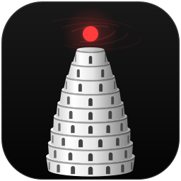
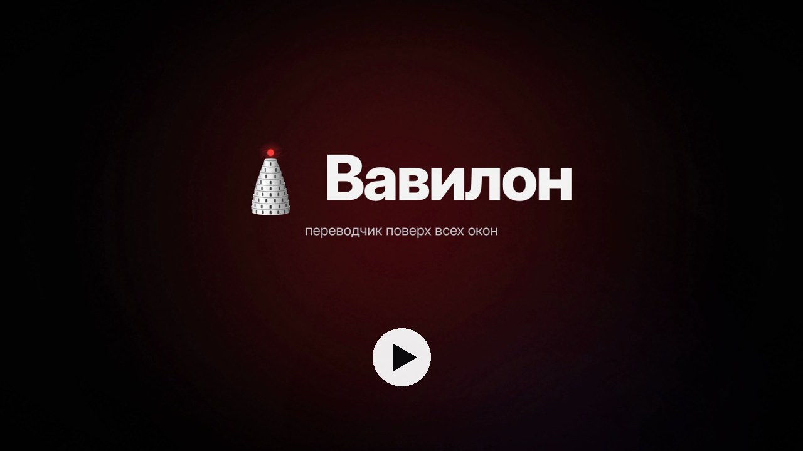
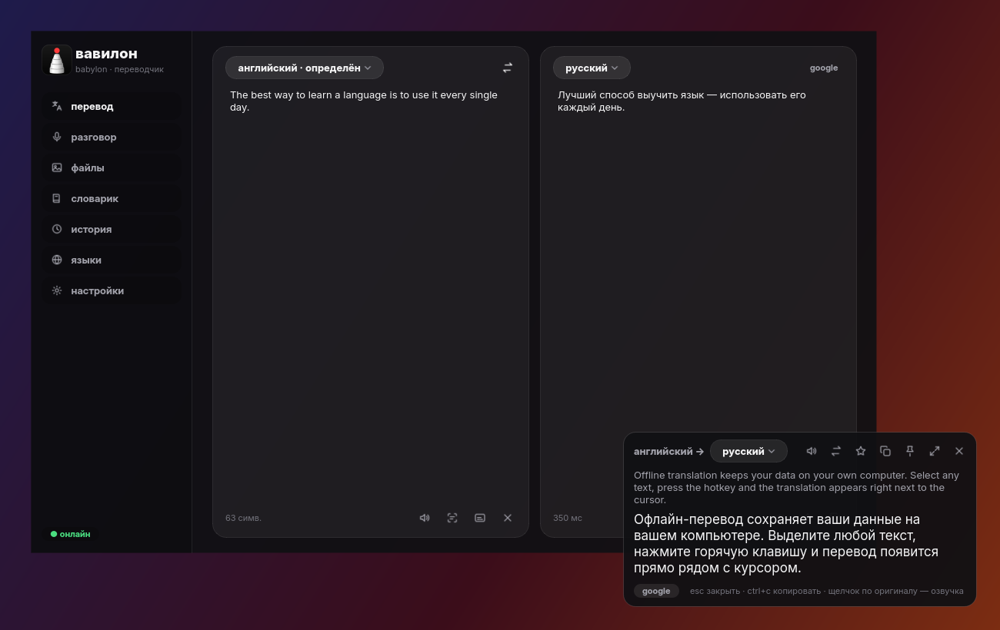
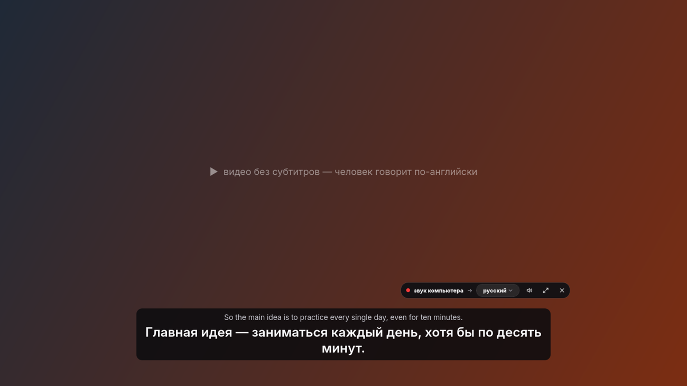
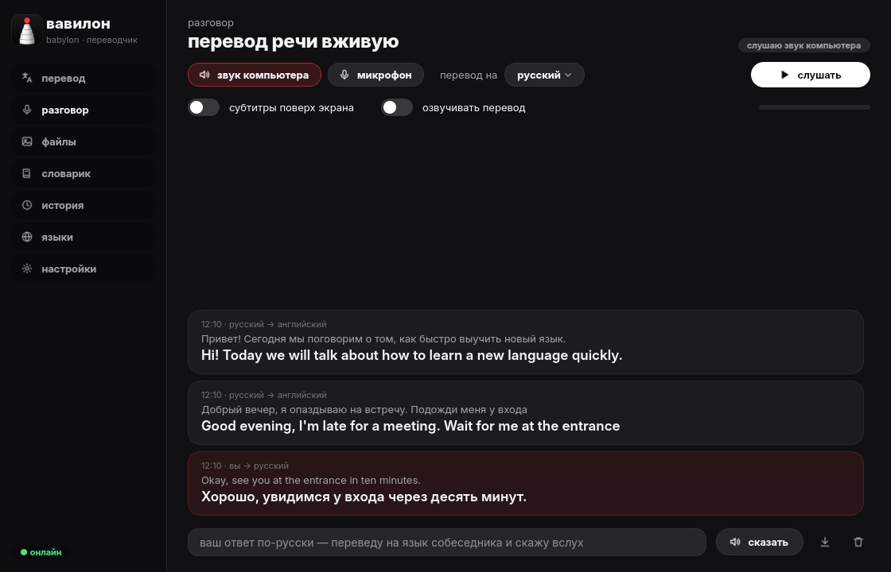
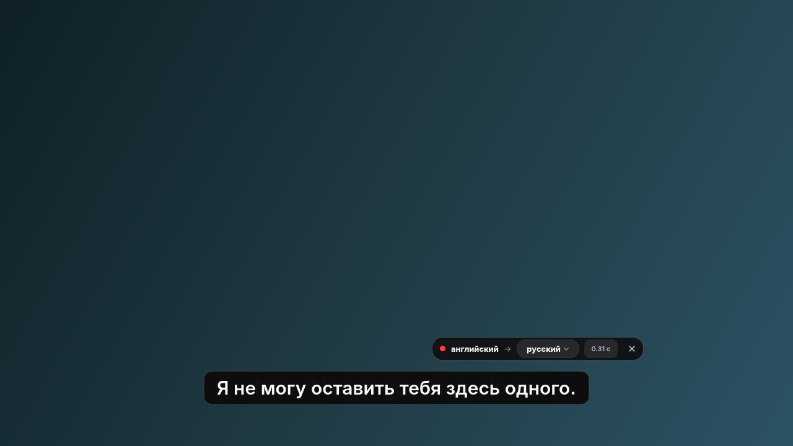
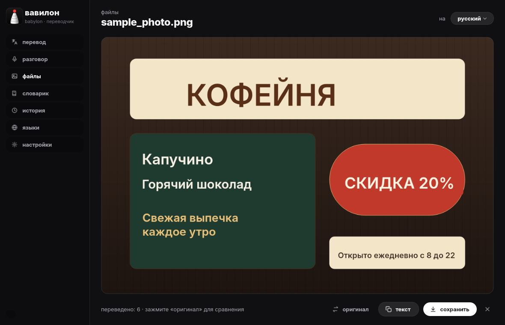
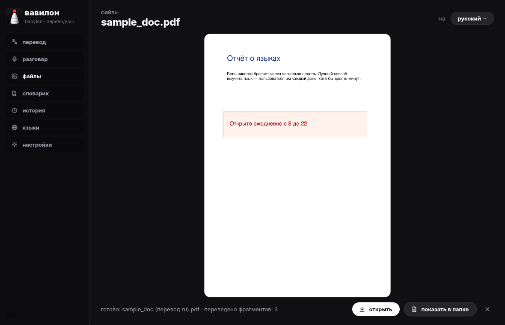
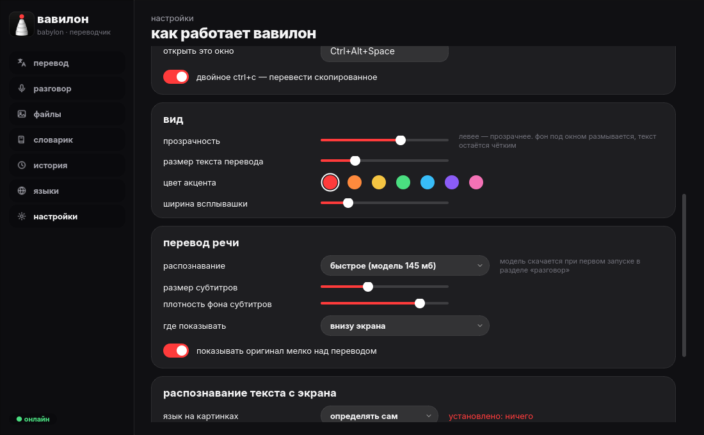

<p align="center"></p>

<h1 align="center">Вавилон · Babylon</h1>

<p align="center"><b>Переводчик для Windows, который работает поверх всех окон.</b><br>
Выделенный текст, субтитры и речь в видео, созвоны, фото, документы. 112 языков, может работать без интернета.<br>
Бесплатно, без рекламы и подписок, с открытым кодом.</p>

<p align="center"><a href="../../releases/latest"><b>⬇ Скачать последнюю версию</b></a> · Windows 10 и 11</p>

> **Hi!** This is my first project that I've decided to share publicly. I started building things only recently, and I'm going to keep working on it — releasing updates and creating new projects.
>
> **Babylon** is a free translator for Windows that lives on top of all your windows: select any text and press a hotkey, get live subtitles for videos and calls (even when the video has none), translate photos, video files and documents right in place. 112 languages, works offline too. No ads, no subscriptions, open source.
>
> *(Ниже — подробное описание на русском. English summary is at the bottom.)*

<p align="center"><a href="docs/promo.mp4"></a><br><sub>▶ ролик о Вавилоне, 41 секунда</sub></p>



> Название — от Вавилонской башни: по легенде, пока её строили, все люди говорили на одном языке. Вавилон возвращает это на ваш экран.

## Что умеет

| | |
|---|---|
| **Перевод выделенного** | Выделите текст в любой программе (браузер, PDF, игра, чат) и нажмите `Ctrl+Alt+T`. Перевод появится рядом с курсором. Для отдельных слов — словарь с вариантами и примерами. |
| **Перевод речи вживую** | Видео без субтитров, YouTube, фильмы, Zoom, Discord, Teams: Вавилон слушает звук компьютера и показывает перевод субтитрами внизу экрана (`Ctrl+Alt+H`). Речь распознаётся прямо на компьютере. |
| **Разговор** | С микрофоном переводит в обе стороны: собеседника — на русский, вас — на его язык. Ответ можно напечатать, и Вавилон скажет его вслух. |
| **Живые субтитры** | Обведите строку субтитров в любом плеере или игре (`Ctrl+Alt+L`). Перевод ляжет прямо на оригинал за доли секунды. |
| **Фото** | Перетащите фото или скриншот: текст заменится переводом прямо на картинке, тем же цветом и на том же месте. |
| **Видео** | Найдёт субтитры и надписи в видеофайле. Смотрите с переводом в окне, сохраните новый mp4 со звуком или субтитры .srt. |
| **Документы** | docx, pdf, txt, srt переводятся с сохранением оформления: стили, таблицы, картинки, цвета. |
| **Текст с экрана** | `Ctrl+Alt+S`: выделите область — текст распознается и переведётся. |
| **Замена переводом** | Пишете по-русски, нажимаете `Ctrl+Alt+R` — выделенный текст заменяется переводом. |
| **Озвучка и словарик** | Озвучка голосами Windows. Слова со звёздочкой попадают в словарик с карточками для заучивания и экспортом в Anki. |
| **Под себя** | Цвет акцента, прозрачность «тёмного стекла», размер и место субтитров, свои горячие клавиши. |

<table>
<tr><td></td><td></td></tr>
<tr><td align="center">Перевод речи из видео субтитрами</td><td align="center">Разговор: перевод в обе стороны и ответ вслух</td></tr>
<tr><td></td><td></td></tr>
<tr><td align="center">Живые субтитры поверх видео</td><td align="center">Перевод прямо на фото</td></tr>
<tr><td></td><td></td></tr>
<tr><td align="center">PDF с переводом: оформление то же</td><td align="center">Цвет, субтитры, обновления — в настройках</td></tr>
</table>

## Чем отличается

| | Вавилон | Обычный онлайн-переводчик |
|---|:---:|:---:|
| Работает в любой программе, а не только на сайте или в браузере | ✓ | — |
| Субтитры к видео и созвонам без субтитров | ✓ | — |
| Перевод поверх игр и плееров | ✓ | — |
| Фото, видео и документы в одном приложении | ✓ | частично |
| Без интернета | ✓ (скачанные языки) | редко |
| Распознавание речи на вашем компьютере | ✓ | обычно на сервере |
| Бесплатно, без рекламы и подписок | ✓ | часто с ограничениями |
| Открытый код | ✓ | — |

## Установка

1. Скачайте `Babylon-<версия>-win64.zip` со страницы [последнего выпуска](../../releases/latest).
2. Распакуйте куда угодно и запустите `Babylon\Babylon.exe`.
3. Если Windows покажет «Windows защитила ваш компьютер»: «Подробнее» → «Выполнить в любом случае». Программа не подписана сертификатом — это платно, а Вавилон бесплатный.

Вавилон живёт в трее у часов (башня). Окно открывается по `Ctrl+Alt+Space` или щелчком по значку.

**Обновление.** «Настройки» → «проверить обновления». Вавилон сам скачает новую версию и поставит её поверх старой. Языки, словарик, история и настройки останутся. Раз в день он проверяет обновления сам (это можно выключить).

## Клавиши

| Что | Сочетание |
|---|---|
| Перевести выделенное | `Ctrl+Alt+T` или дважды `Ctrl+C` |
| Перевод речи из звука компьютера (вкл/выкл) | `Ctrl+Alt+H` |
| Живые субтитры (вкл/выкл) | `Ctrl+Alt+L` |
| Текст с области экрана | `Ctrl+Alt+S` |
| Заменить выделенное переводом | `Ctrl+Alt+R` |
| Открыть окно | `Ctrl+Alt+Space` |

Все сочетания меняются в настройках.

## Приватность

- **Онлайн-режим** (по умолчанию): текст для перевода отправляется в Google Translate, запасной вариант — MyMemory. В настройках можно выбрать «только без интернета» — тогда переводят скачанные языки, и ничего не уходит в сеть.
- **Речь** распознаётся нейросетью Whisper прямо на компьютере. Звук никуда не отправляется, в интернет уходит только распознанный текст для перевода (или не уходит в офлайн-режиме).
- **Фото и экран** распознаёт встроенный OCR Windows, тоже на компьютере.
- Вавилон не собирает статистику. В сеть он обращается только для перевода, скачивания языков и моделей и проверки обновлений на GitHub.
- История, словарик и настройки хранятся в `%LOCALAPPDATA%\Babylon`.

## Для распознавания текста на картинках

Нужен языковой пакет Windows с распознаванием: Параметры → Время и язык → Язык и регион → добавить язык → Языковые параметры → «Оптическое распознавание символов». Английский обычно уже есть.

## Как это устроено

Python 3.12 + PySide6 (Qt). Онлайн — Google Translate (с запасным MyMemory), офлайн — модели [Argos Translate](https://github.com/argosopentech/argos-translate) через [CTranslate2](https://github.com/OpenNMT/CTranslate2). Речь — [Whisper](https://github.com/openai/whisper) (модели [faster-whisper](https://huggingface.co/Systran)) через тот же CTranslate2. Звук — [soundcard](https://github.com/bastibe/SoundCard), OCR и голоса — Windows, видео — ffmpeg ([imageio-ffmpeg](https://github.com/imageio/imageio-ffmpeg)), документы — [python-docx](https://github.com/python-openxml/python-docx) и [PyMuPDF](https://github.com/pymupdf/PyMuPDF).

| Файл | Что делает |
|---|---|
| `babylon/app.py` | связывает всё: клавиши, окна, перевод, обновления |
| `babylon/translator.py`, `online.py`, `engine.py` | перевод онлайн и офлайн |
| `babylon/asr.py`, `audio.py`, `hear.py` | распознавание речи, захват звука, перевод речи вживую |
| `babylon/live.py` | живые субтитры по картинке экрана |
| `babylon/lens.py`, `video.py`, `docs.py` | перевод на фото, в видео и документах |
| `babylon/ocr.py`, `speech.py`, `winapi.py` | OCR, голоса и горячие клавиши Windows |
| `babylon/updater.py` | проверка, скачивание и установка новых версий |
| `babylon/ui/` | окна: «тёмное стекло», всплывашка, разделы, субтитры |
| `tests/` | проверки (часть — только на Windows) |
| `promo/` | промо-ролик: анимация кодом и её рендер |

**Запуск из исходников:**

```bat
pip install -r requirements.txt
python run_babylon.py
```

**Сборка:** `build.bat` → `dist\Babylon\Babylon.exe`. **Проверки:** `python -m pytest tests`.

Выпуски собирает GitHub Actions: новая версия в `babylon/config.py` (или тег `vX.Y.Z`) → проверки на Windows → архив `Babylon-X.Y.Z-win64.zip` в разделе Releases.

## Лицензия

[GPL-3.0](LICENSE). Вавилон бесплатен и останется бесплатным: код открыт, его можно изучать, менять и распространять на тех же условиях.

Используемые компоненты — под своими лицензиями: PySide6 (LGPL-3.0), CTranslate2 и Whisper (MIT), модели Argos Translate (MIT / CC), PyMuPDF (AGPL-3.0), ffmpeg (GPL), шрифт Inter (SIL OFL).

---

<details>
<summary><b>English</b></summary>

**Babylon** is a free, open-source translator for Windows that works on top of every app: select text and press a hotkey, translate live speech from videos and calls (speech is recognized locally with Whisper), overlay translated subtitles on any player or game, translate photos in place (like Google Lens), video files and documents (docx/pdf with layout preserved). 112 languages online, offline mode with downloadable models. No ads, no subscriptions, no telemetry. Licensed under GPL-3.0.

[Download the latest release](../../releases/latest) — Windows 10/11.
</details>
